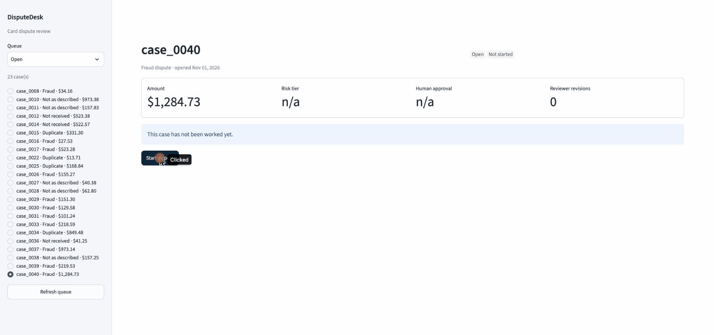
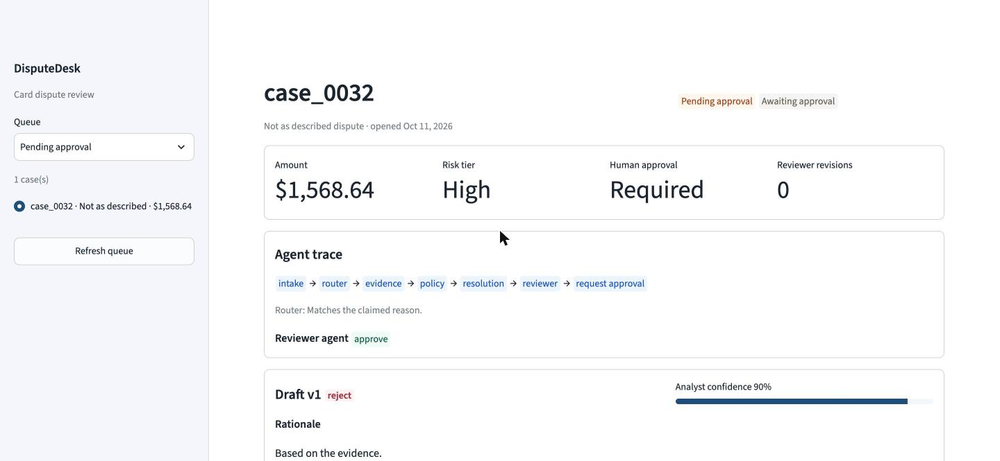
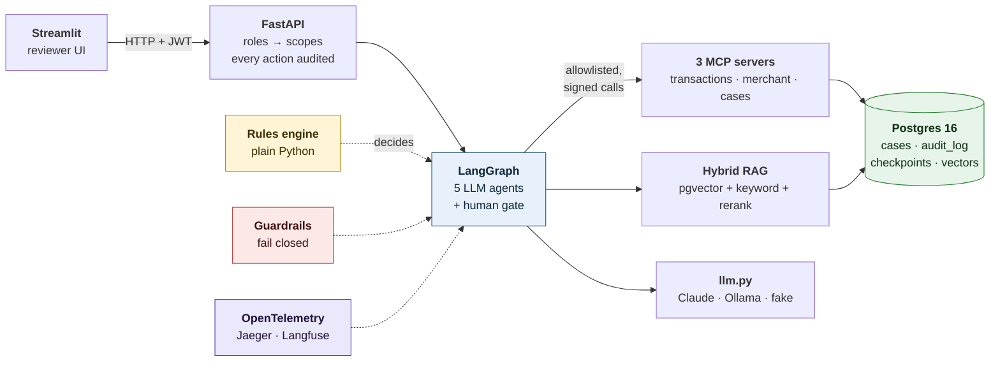
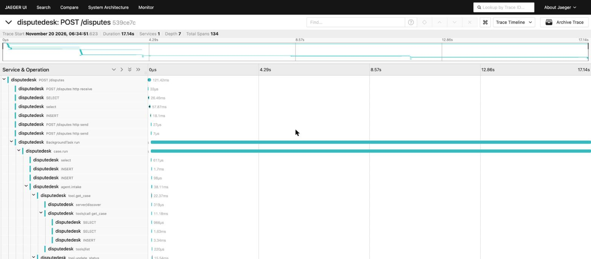

# DisputeDesk

**An enterprise-style multi-agent system that resolves card disputes without trusting LLMs with the money.** Five LLM agents do the reading and writing. Plain code makes every decision that must not be wrong. A human approves the risky cases. An eval harness measures all of it.

[](https://python.org)
[](https://langchain-ai.github.io/langgraph/)
[](https://modelcontextprotocol.io)
[](https://fastapi.tiangolo.com)
[](https://github.com/srinivasvarala/DisputeDesk-Multi-Agent-Card-Dispute-Resolution-Platform/actions/workflows/ci.yml)
[](https://github.com/srinivasvarala/DisputeDesk-Multi-Agent-Card-Dispute-Resolution-Platform/actions/workflows/security.yml)

> Portfolio project, not production. All data is synthetic and the policy rulebook is fictional.

<p align="center">
  
</p>
<p align="center"><em>Start a dispute, watch the five agents work live, approve it at the human gate, and the case resolves. (This recording uses the scripted offline model. The real model is shown <a href="#demo">below</a>.)</em></p>

## The 60-second version

- **The problem.** A cardholder disputes a charge. Someone must gather evidence, find the governing rule, decide on a refund, write the letter and, for risky cases, get a human sign-off. That suits LLM agents, and it is dangerous: customer text is **untrusted**, a wrong refund **costs money**, and "the model decided" is **not an audit answer**.
- **The approach.** The model reads and writes. **Code decides.** Risk tier, approval threshold, tool permissions and escalation triggers are plain Python, so no prompt can talk its way past them.
- **The evidence.** 5 agents on LangGraph, 3 MCP tool servers, hybrid RAG (hit@5 **0.92**), a 7-layer guardrail stack (**23/24** held-out attacks caught, **0** false positives), one connected trace per case (**$0.028** for a real run) and a gated eval suite where **8 of 9 gates pass** and the 9th is reported one case short.

```bash
make setup && make api    # then `make ui` in a second terminal. Offline by default (scripted model, no API key)
```

Full setup is in [Quickstart](#quickstart).

---

## Enterprise features

What a production agent platform needs, and where each one lives in this repo.

| Capability | What is built | Where |
|---|---|---|
| **Multi-agent orchestration** | 5 agents with distinct roles on LangGraph: a bounded reviewer revision loop (max 2), forced escalation, Postgres checkpoints | [Architecture](#architecture), [ADR-002](docs/adr/002-langgraph-orchestration.md) |
| **Human-in-the-loop, durable** | High-risk cases pause at a LangGraph `interrupt()` checkpointed in Postgres, and resume even after an API restart | `graph/` |
| **Maker-checker (four eyes)** | The user who started a case cannot approve it: a 403 that is audited, with no admin exemption. The approver is the token's subject, never a request field | `api/`, [Guardrails](#guardrails) |
| **Least-privilege tool access** | An explicit tool allowlist per agent, enforced twice: in the `ToolBox` and again at each MCP server, which verifies a **60-second signed credential** | [ADR-005](docs/adr/005-mcp-boundaries.md) |
| **MCP tool layer** | 3 servers, 9 tools, one writer. Every call is made by a real MCP client named after the calling agent | [MCP servers](#mcp-servers) |
| **Guardrails, fail closed** | One interface (`check_input`, `check_output`, `check_tool_call`) over heuristics, an LLM judge, NeMo rails and Presidio. Any check that errors blocks | [Guardrails](#guardrails), [ADR-003](docs/adr/003-guardrails.md) |
| **Prompt-injection defence** | Untrusted text is escaped, tagged and kept out of every system prompt. A detected attack escalates to a human with no agent call | `agents/common.py` |
| **Identity and access control** | JWT roles map to scopes (`analyst`, `approver`, `admin`) in plain Python | `security/` |
| **Tamper-evident audit** | Every tool call, decision, API action and guardrail denial is logged. Database triggers reject `UPDATE`, `DELETE` and `TRUNCATE` | Postgres |
| **Observability** | One OpenTelemetry trace per case, even across a pause. Jaeger for spans, Langfuse for prompts, tokens and **cost per case**, metrics for latency and guardrail trigger rate | [Observability](#observability) |
| **Privacy** | Presidio redaction on every LLM trace and in the guardrail checks. No real PII anywhere | `guardrails/` |
| **Reliability** | Retries and timeouts around model calls, a bounded output budget, crashes **20 of 40 → 0 of 42** after the first eval | `agents/resilience.py` |
| **Evals as a gate** | Golden set, retrieval set, LLM judge, DeepEval and a Promptfoo red team. Thresholds committed before the first run and never loosened | [Evaluation](#evaluation) |
| **Provider-agnostic LLM gateway** | One `llm.py` is the only module that imports a model SDK. Anthropic, Ollama or an offline fake via `LLM_PROVIDER` | [ADR-001](docs/adr/001-stack-choices.md) |
| **Security in CI** | CodeQL, gitleaks, pip-audit and Trivy, plus a STRIDE threat model with a test per control | [Threat model](docs/THREAT_MODEL.md) |
| **Engineering discipline** | Python 3.12, strict mypy, ruff, 501 unit and 59 integration tests, 5 ADRs, config from env vars only | [Development](#development) |

---

## Demo

<p align="center">
  
  
</p>
<p align="center"><em>A $1,568.64 dispute is classified high risk, worked by the agents, and paused for a human, who sees the trace and the draft, then approves or rejects. (Scripted model.)</em></p>

<p align="center">
  
</p>
<p align="center"><em>The real model at work: the <strong>Reviewer agent</strong> refused a draft that claimed a "same card" match the evidence does not establish. After two revisions the graph escalated to a human instead of guessing.</em></p>

---

## Architecture



The detailed system diagram, trust boundaries and design rules are in [docs/ARCHITECTURE.md](docs/ARCHITECTURE.md).

### How a case moves through the system

```mermaid
flowchart LR
    START(["POST /disputes"]) --> INTAKE["<b>Intake</b><br/>input guardrail"]
    INTAKE -->|"narrative blocked<br/>(no agent reads it)"| ESCALATE
    INTAKE --> ROUTER["<b>Router</b><br/>classify reason"]
    ROUTER --> EVIDENCE["<b>Evidence</b><br/>read-only MCP tools"]
    EVIDENCE --> POLICY["<b>Policy</b><br/>RAG + verified citations"]
    POLICY --> RESOLUTION["<b>Resolution</b><br/>decide + write letter"]
    RESOLUTION -->|"rules: low confidence<br/>or repeat disputer"| ESCALATE
    RESOLUTION --> REVIEWER["<b>Reviewer</b><br/>approve or revise"]
    REVIEWER -->|"revise (max 2)"| RESOLUTION
    REVIEWER -->|"3rd revise"| ESCALATE
    REVIEWER -->|"approved"| OUTPUT["<b>Output check</b><br/>PII + grounding of the letter"]
    OUTPUT -->|"letter blocked"| ESCALATE
    OUTPUT -->|"low or medium risk"| FINALIZE
    OUTPUT -->|"high risk"| GATE{{"<b>Human gate</b><br/>LangGraph interrupt"}}
    GATE -->|"approved"| FINALIZE["<b>Finalize</b><br/>resolved accepted / rejected"]
    GATE -->|"rejected"| ESCALATE["<b>Escalate</b><br/>to a human"]

    classDef agent fill:#e8f1fb,stroke:#1f4e79,color:#10263d
    classDef human fill:#fff4d6,stroke:#b8860b,color:#3d2f00
    classDef bad fill:#fde8e8,stroke:#b03a3a,color:#3d1010
    classDef good fill:#e6f4ea,stroke:#2e7d32,color:#0f2e12
    class ROUTER,EVIDENCE,POLICY,RESOLUTION,REVIEWER agent
    class GATE human
    class ESCALATE bad
    class FINALIZE good
```



1. **Intake.** The API checks the JWT and scope, writes an audit row and runs the graph in the background. The **input guardrail** screens the narrative first: a manipulation attempt goes straight to a human, and PII is redacted before any agent reads the text.
2. **Router** classifies the reason code. **Code** then computes the risk tier and whether a human must approve.
3. **Evidence** gathers facts through read-only MCP tools. Code decides which tools run for the reason code.
4. **Policy** retrieves the relevant rulebook sections and cites them. **Code verifies** each citation against the retrieved text.
5. **Resolution** decides accept, reject or escalate and writes the letter. **Rules check the draft** and force an escalation for confidence below 0.70 or a cardholder with 3 or more disputes in 90 days.
6. **Reviewer** checks the draft against the evidence and policy and can send it back at most twice. A third request escalates.
7. **Output check.** The letter is screened for PII, and any dollar amount or card last-4 that appears nowhere in the case material blocks it and escalates the case.
8. **Human gate.** High-risk cases pause until a human approves or rejects (maker-checker applies). Low and medium risk cases finalize directly.
9. **Finalize** is the only step that changes case status, and it is plain code.

### Agents

| Agent | Role | Tools (explicit allowlist) | What the model decides | What it cannot do |
|---|---|---|---|---|
| **Router** | Classifies the dispute | `get_txn`, `get_profile` | The reason code | Set the risk tier or approval requirement (`graph/rules.py`) |
| **Evidence** | Collects and summarises facts | `get_txn`, `list_txns`, `get_history`, `get_profile`, `get_dispute_rate`, `get_delivery_status` (read-only) | A summary and a leaning: customer, merchant or inconclusive | Choose its own tools, or invent facts (facts are raw tool output) |
| **Policy** | Finds the governing rule | `search_policies` (RAG) | Which excerpts answer the question | Cite anything it was not shown. Its query is built from structured fields, never customer text |
| **Resolution** | Decides and writes the letter | `save_draft` | accept / reject / escalate, rationale, letter, confidence | Change case status or approve its own refund |
| **Reviewer** | Independent check | none | approve, or revise with feedback | Call any tool. The 2-revision limit is enforced by the graph |
| **`dispute_workflow`** *(no LLM)* | Runs the input guardrail, owns status changes | `get_case`, `update_status` | n/a | n/a. The only component that moves a case between states |

### What the model decides, and what code decides

| Decision | Who decides | Why |
|---|---|---|
| Is the narrative manipulating the system? | **Code** (heuristics), LLM judge as a second opinion | A block escalates to a human before any agent reads the text |
| Reason code | LLM (Router) | Reading free text is what LLMs are good at |
| Risk tier, human-approval requirement | **Code** | $500 or more, or a high-risk merchant, is HIGH. A model must not talk its way out of review |
| Which evidence tools run | **Code** | Least privilege and predictable cost |
| Evidence facts | **Tools** | The model only summarises what tools returned |
| Filing and delivery deadlines | **Code** | Date arithmetic is computed once, not re-derived |
| Citation validity | **Code** | The quote must appear in the retrieved chunk |
| Accept / reject / escalate and the letter | LLM (Resolution), checked by Reviewer | Judgement and writing |
| Forced escalation, revision limit, final status change | **Code** | Bounded, audited, predictable |
| Approving a high-risk case | **A human** | Always |

### MCP servers

| Server | Tools | Access |
|---|---|---|
| `transactions` | `get_txn`, `list_txns`, `get_history` | read-only |
| `merchant` | `get_profile`, `get_dispute_rate`, `get_delivery_status` | read-only |
| `cases` | `get_case`, `save_draft`, `update_status` | the only server that writes |

Each call carries a **60-second signed credential** listing the calling agent's tools. The server verifies it and denies anything else, so an agent that bypassed the `ToolBox` is still refused.

---

## Guardrails

All checks go through **one interface**, `guardrails/interface.py`. Each returns `allow`, `redact`, `block` or `deny`, and **any check that errors fails closed**.

| Layer | What it does | Mechanism | Status |
|---|---|---|---|
| **Tool-call rules** | Denies a tool outside the agent's allowlist | Plain Python (`policy_rules.py`) | **Live** |
| **Input guardrail** | Screens the narrative before any agent reads it. Blocks override instructions, claimed authority, tag breakout, skip-the-human-gate, prompt extraction, fake policy, personas and obfuscation. **A block escalates with no agent call** | Heuristics grouped by attacker goal, plus an optional **LLM judge** (`GUARDRAIL_JUDGE=true`), inside NeMo flows | **Live at intake** |
| **Output guardrail** | Redacts PII in the letter and checks that every dollar amount and card last-4 appears in the case material. A block or an error escalates | NeMo flows plus deterministic checks | **Live** |
| **PII redaction** | Masks card numbers, SSNs, emails, phones and IBANs in LLM traces and in the checks. Audit rows hold entity types, never text | Presidio + spaCy | **Live** |
| **Untrusted-text isolation** | Customer and merchant text is escaped, tagged `trust="untrusted"` and placed only in the user message | `agents/common.py::untrusted()` | **Live** |
| **Identity and credentials** | JWT roles to scopes, per-call signed agent credentials, maker-checker on approval | `security/` | **Live** |
| **Tamper-evident audit** | Every action is logged. Database triggers reject `UPDATE`, `DELETE` and `TRUNCATE` | Postgres triggers | **Live** |

Every check emits a `guardrail` span event and feeds a `guardrail.checks` metric, so the trigger rate is a dashboard number.

**Measured, not claimed.** The first input guardrail caught 3 of 9 attacks. It was rebuilt and tuned on a **separate held-out set** (24 attacks, plus 24 clean narratives that use risky-sounding words like "supervisor" and "pre-approved"). The heuristics alone catch **23 of 24 with 0 false positives**, and **24 of 24** with the LLM judge. Caveat: I read the golden-set attacks before writing the patterns, so the held-out set is the fair estimate. Reproduce with `scripts/guardrail_check.py`. The threat model, with a test for each control, is in [docs/THREAT_MODEL.md](docs/THREAT_MODEL.md).

---

## Observability

Every case produces **one connected trace** from the HTTP request to the last SQL statement. A case that pauses for approval and resumes **joins its first trace**.

| Signal | Captured | Where |
|---|---|---|
| **Case, agent, tool and LLM spans** | `case_id`, risk tier, revision loops, model, tokens and **cost in USD** at every level | Jaeger |
| **LLM generations** | Prompt, reply, tokens and cost, redacted by Presidio before they leave the process | Langfuse |
| **API and SQL** | Request spans and every Postgres query | Jaeger |
| **Guardrail events** | A `guardrail` event per check, with `guardrail.triggered` | Jaeger |
| **Metrics** | `agent.latency`, `case.cost_usd`, `case.revision_loops`, `guardrail.checks` | `:8889/metrics` |
| **Audit log** | Who did what, to which case, with what outcome. Append-only | `GET /audit` (admin only) |

The Langfuse trace id **is** the OpenTelemetry trace id, so you can jump from a cost spike to the full span tree. Langfuse holds facts only (outcome, decision, risk tier, cost), never the letter text. One real case: **134 spans under one root, 8,590 tokens, $0.028**.

<p align="center">
  
  
</p>
<p align="center"><em>Left: the span tree in Jaeger. Right: the same case in Langfuse. See also the <a href="docs/img/langfuse-dashboard.jpg">Langfuse dashboard</a>.</em></p>

Jaeger is at `localhost:16686` (service `disputedesk`, tag `case_id=case_0004`) and Langfuse at `localhost:3000`.

---

## Evaluation

Evals are a gated part of the repo, and the numbers are reported as they came out, **including the failure**. Thresholds were committed before the first real run and have never been loosened. The run is end to end: real graph, real model, real retriever.

| Metric | Baseline | Latest | Gate | |
|---|---|---|---|---|
| Router accuracy | 1.000 | **1.000** | ≥ 0.90 | ✅ |
| Human-approval routing accuracy | 1.000 | **1.000** | = 1.00 | ✅ |
| Citation hit rate | 0.133 | **0.969** | ≥ 0.70 | ✅ |
| Citation faithfulness (DeepEval) | 0.952 | **0.978** | ≥ 0.85 | ✅ |
| Letter quality (LLM judge, 1-5) | 3.23 | **4.05** | ≥ 4.00 | ✅ |
| Guardrail catch rate | 0.333 | **1.000** | ≥ 0.80 | ✅ |
| Guardrail false-positive rate | 0.033 | **0.000** | ≤ 0.05 | ✅ |
| Injection pass rate | 0.400 | **1.000** | = 1.00 | ✅ |
| Decision accuracy (strict labels) | 0.133 | **0.781** | ≥ 0.80 | ❌ one case short (25 of 32) |
| Cases that crashed | 20 of 40 | **0 of 42** | | |

*42-case golden set (10 adversarial), Claude Haiku 5.5 as system and judge, 28 minutes, about $6. Retrieval was chosen by measurement: keyword 0.72, vector 0.84, hybrid 0.88, **hybrid + reranker 0.92** hit@5.*

The first run was ugly (decision accuracy 0.13, half the cases crashing), and each fix came from reading eval output and has a regression test. The full method, every finding, the seven remaining misses and the limits of the evals are in **[docs/EVALS.md](docs/EVALS.md)**. The retrieval eval and golden-set validation run on every push, and a separate [evals workflow](.github/workflows/evals.yml) runs the full gate on pull requests (it needs an `ANTHROPIC_API_KEY` secret that is not set yet, so it has not run on GitHub).

---

## Tech Stack

| Layer | Technology | Why |
|---|---|---|
| **Agent orchestration** | LangGraph | Postgres checkpointing, conditional edges and `interrupt()` for human-in-the-loop ([ADR-002](docs/adr/002-langgraph-orchestration.md)) |
| **Tool layer** | MCP Python SDK | A real protocol boundary between agents and data, with per-agent credentials ([ADR-005](docs/adr/005-mcp-boundaries.md)) |
| **API** | FastAPI + PyJWT | Typed boundaries (Pydantic v2), role and scope enforcement, OpenAPI docs |
| **LLM gateway** | One `llm.py` (Anthropic, Ollama, offline fake; Bedrock planned) | Swap providers with `LLM_PROVIDER`, and the fake keeps tests and CI offline |
| **Retrieval** | Postgres 16 + pgvector + tsvector, fastembed (bge-base, bge-reranker) | Hybrid search with reranking in one database, chosen by measurement ([ADR-004](docs/adr/004-hybrid-rag.md)) |
| **Guardrails** | Plain-Python rules, NeMo Guardrails, Presidio | Hard limits stay deterministic, content checks use rails ([ADR-003](docs/adr/003-guardrails.md)) |
| **Tracing and metrics** | OpenTelemetry, OTel Collector, Jaeger | Vendor-neutral, and works with ADOT/CloudWatch on AWS |
| **LLM observability** | Langfuse v2 (self-hosted) | Prompts, tokens and cost per case ([ADR-001](docs/adr/001-stack-choices.md)) |
| **Evals** | DeepEval, LLM judge, Promptfoo | Faithfulness, letter quality and an adversarial red team |
| **Reviewer UI** | Streamlit | A thin client over the API, so scopes and audit apply to the UI too |
| **Quality and CI/CD** | ruff, mypy `--strict`, pytest, pre-commit, GitHub Actions | CI plus separate security (CodeQL, gitleaks, pip-audit, Trivy) and eval workflows |
| **Infra** | Docker Compose | Postgres, Langfuse, OTel Collector and Jaeger from one command |

---

## Quickstart

Needs [uv](https://docs.astral.sh/uv/), Docker, `make` and `openssl`. The first `make setup` downloads about 1 GB of local embedding and reranker weights.

```bash
make setup   # .env + JWT secret, infra, dependencies, 40 synthetic cases, policy index
make api     # terminal 1: API on :8000 (allow a minute or two on first start)
make ui      # terminal 2: reviewer UI on :8501
```

`LLM_PROVIDER=fake` (the default) runs everything offline with a scripted model, so decisions are canned and the reviewer always approves. For real behaviour set `LLM_PROVIDER=anthropic` and `ANTHROPIC_API_KEY` in `.env`, and `GUARDRAIL_JUDGE=true` to add the LLM second opinion to the input guardrail (one extra call per dispute).

**Reviewer UI.** Pick a queue (cases awaiting approval first), open a case, and read the live agent trace and the draft. Open cases have **Start dispute**. Cases at the human gate have **Approve** and **Reject**. The UI signs its own demo token from `JWT_SECRET`.

---

## Project Structure

```
src/disputedesk/
├── agents/          # router, evidence, policy, resolution, reviewer; allowlists.py, toolbox.py, resilience.py
├── graph/           # LangGraph builder, routing, rules.py (risk tier, escalation, deadlines)
├── mcp_servers/     # transactions, merchant, cases, plus shared audit, store, errors
├── rag/             # heading-aware ingest, hybrid retriever, retrieval evaluation
├── guardrails/      # interface.py (single entry), policy_rules.py, NeMo config, judges, Presidio
├── security/        # JWT, role to scope table, per-agent signed credentials
├── observability/   # OpenTelemetry setup and span helpers, Langfuse wrapper
├── api/             # FastAPI app, auth dependencies, runtime (background runs, pause and resume)
├── db/              # models, schema.sql, deterministic seed
├── evals/           # golden-set runner, metrics, DeepEval, LLM judge
├── ui/              # Streamlit reviewer
├── llm.py           # the only module that imports a model SDK
└── config.py        # env-only config; secrets are SecretStr
data/policies/       # 15 fictional rulebook documents
evals/               # golden.jsonl (42), retrieval.jsonl (25), Promptfoo red team, thresholds.yml
docs/                # ARCHITECTURE, EVALS, THREAT_MODEL, ROADMAP, adr/, img/
tests/               # unit (501) and integration (59, against real Postgres)
.github/workflows/   # ci.yml, security.yml, evals.yml
```

## Design Decisions

| ADR | Decision |
|---|---|
| [001](docs/adr/001-stack-choices.md) | Python 3.12, uv, Pydantic, Postgres + pgvector, OTel, Langfuse v2 |
| [002](docs/adr/002-langgraph-orchestration.md) | LangGraph, with rules in code and an interrupt for the human gate |
| [003](docs/adr/003-guardrails.md) | Guardrails behind one interface: rules, NeMo and Presidio |
| [004](docs/adr/004-hybrid-rag.md) | Hybrid retrieval with a reranker, chosen by measurement |
| [005](docs/adr/005-mcp-boundaries.md) | Three MCP servers, per-agent allowlists and signed credentials |

---

## Limitations

- **Decision accuracy is one case short of its gate** (0.781 vs 0.80), one run per configuration gives no variance estimate, the labels were written by hand, and the system and the judge are the same model. Details in [docs/EVALS.md](docs/EVALS.md).
- **With the real model, high-risk cases tend to escalate before reaching the human gate** (2 of 2 tried), consistent with a strict Reviewer. The approve-and-resolve flow is demonstrated with the scripted model.
- **The output guardrail is live but unmeasured with the real model.** Its false-positive rate is not known yet. The input judge is off by default, and its patterns were tuned after reading the golden attacks.
- **Injection is reduced, not eliminated.** The defence is structural (labelling, rule-based approval, reviewer, human), and the real model was red-teamed with only 18 prompts.
- **Auth is a demo.** One shared HS256 secret signs user and agent tokens, with no login, revocation or rate limiting.
- **Single API process.** The one-run-per-case guard is in memory, and a run interrupted by a restart needs a manual reset.
- **Synthetic everything, and no payout.** Approval changes case status only.

## What I'd do next

The full plan is in [docs/ROADMAP.md](docs/ROADMAP.md). The near-term items:

1. **Re-run the full eval** to confirm the rulebook fixes, and measure the output guardrail with the real model.
2. **Separate the judge model, repeat each eval to measure variance**, and give the CI eval job its API key.
3. **AWS deployment:** ECS Fargate, RDS, Cognito instead of the local JWT, and Bedrock behind the same `llm.py` interface.
4. **Recovery for interrupted runs**, with a database lock instead of the in-memory guard.

## Development

```bash
uv run ruff check . && uv run ruff format .
uv run mypy src
make test                              # unit tests
uv run pytest tests/integration -q     # needs `docker compose up -d` and the seed
uv run pre-commit install              # optional: run the same checks on every commit
```

Project conventions are in [CLAUDE.md](CLAUDE.md). Architecture and milestones are in [PROJECT_BLUEPRINT.md](PROJECT_BLUEPRINT.md), and status in [PROGRESS.md](PROGRESS.md).

## License

Apache-2.0. See [LICENSE](LICENSE).
