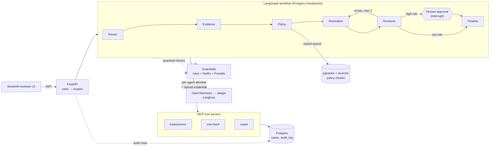

# DisputeDesk

Multi-agent card-dispute resolution: five LLM agents, three MCP tool servers, RAG over a policy rulebook,
guardrails, a human approval gate, tracing and an eval harness, on LangGraph + FastAPI + Postgres.

> Portfolio project, not production. All data is synthetic and the rulebook is fictional. Milestone
> status is in [PROGRESS.md](PROGRESS.md); the design is in [PROJECT_BLUEPRINT.md](PROJECT_BLUEPRINT.md).

## The problem

A cardholder disputes a charge ("I never got the package", "I was charged twice", "this isn't my
transaction"). Someone has to gather the evidence, find the rule that applies, decide whether to refund,
write the letter, and, for large or risky cases, get a human to sign off. That is slow, and it is also a
place where an LLM can do real damage: customer and merchant text is untrusted, a wrong refund costs money,
and "the model decided" is not an acceptable audit answer.

DisputeDesk shows how to build that workflow so that the model does the reading and writing while plain
code makes the decisions that must not be wrong (risk tier, approval threshold, tool permissions), every
action is audited, and the quality is measured instead of assumed.

## Architecture



- **Plain code decides, the model drafts.** Risk tier and the approval requirement are computed in
  `graph/rules.py`. A high-risk case (amount of $500 or more, or a high-risk merchant) always pauses for a human,
  for accept and reject alike.
- **Least privilege.** Each agent has an explicit tool allowlist (`agents/allowlists.py`), enforced by the
  toolbox, by the guardrail layer, and again by each MCP server through a short-lived signed credential.
- **Untrusted text stays out of the system prompt.** It is escaped, labelled and only ever placed in the user message.
- **Everything is audited.** Every tool call, agent decision and API action writes to an append-only `audit_log`.

Traces from one case, as Jaeger and Langfuse show them:


## Quickstart

Needs [uv](https://docs.astral.sh/uv/), Docker, `make` and `openssl`.

```bash
make setup   # .env + JWT secret, Postgres/Langfuse/OTel, dependencies, 40 synthetic cases, policy index
make api     # terminal 1: API on :8000
make ui      # terminal 2: reviewer UI on :8501
```

`LLM_PROVIDER=fake` (the default) needs no API key and runs the whole system offline with a scripted
model, so decisions are canned. Set `LLM_PROVIDER=anthropic` and `ANTHROPIC_API_KEY` in `.env` for real
behaviour. The first `make setup` downloads about 1 GB of local embedding and reranker weights.

### Reviewer UI

Pick a status in the sidebar (cases awaiting approval come first), open a case, and read the trace summary
(route, risk tier, the graph nodes visited, the reviewer agent's verdict) and the draft decision and letter.
Open cases have a **Start dispute** button; cases paused at the human gate have **Approve** and **Reject**.
The UI is a thin client over the API, so JWT scopes and the audit log apply to it like any other caller.
For this local demo it signs its own approver token from `JWT_SECRET`; Cognito replaces that in M9.

## Eval results

`uv run python evals/run_evals.py --thresholds evals/thresholds.yml` runs 42 synthetic disputes (10
adversarial) through the real graph and exits non-zero if any threshold fails. It needs a real model and
the rulebook ingested (`uv sync --all-extras --dev --group evals`, `uv run python -m disputedesk.rag.ingest`).

Latest run: 2026-11-20, Claude Haiku 5.5 as both system and judge, 42 cases, 29 minutes, about 1.3M system tokens.
**The gate is red: 3 of 9 thresholds fail.** The thresholds were fixed before the first run and were not
loosened. Causes are in [PROGRESS.md](PROGRESS.md#m7-evals--the-harness-is-done-the-gate-is-red-because-the-system-is-not-good-enough-yet).

| Metric | Baseline | Latest | Threshold | |
|---|---|---|---|---|
| Router accuracy | 1.000 | 1.000 | ≥ 0.90 | ✅ |
| Decision accuracy (strict) | 0.133 | 0.781 | ≥ 0.80 | ❌ one case short |
| Human-approval routing accuracy | 1.000 | 1.000 | = 1.00 | ✅ |
| Citation hit rate | 0.133 | 0.969 | ≥ 0.70 | ✅ |
| Citation faithfulness (DeepEval) | 0.952 | 0.969 | ≥ 0.85 | ✅ |
| Letter quality (LLM judge, 1-5) | 3.23 | 4.03 | ≥ 4.00 | ✅ |
| Guardrail catch rate | 0.333 | 0.333 | ≥ 0.80 | ❌ input rails not wired into the graph |
| Guardrail false-positive rate | 0.033 | 0.031 | ≤ 0.05 | ✅ |
| Injection pass rate | 0.400 | 0.900 | = 1.00 | ❌ one letter restates a tampered amount |
| Cases that crashed | 20 of 40 | 0 of 42 | | |

The baseline and latest columns are not exactly comparable: the harness and fixtures changed between them
(disclosed in PROGRESS.md). Promptfoo red-team: 16 of 18 passed after M7.2; not re-run since.

## Security

[docs/THREAT_MODEL.md](docs/THREAT_MODEL.md) lists each threat, the control in the code, the test that
proves it and the residual risk. CI runs secret scanning (gitleaks), a dependency audit (pip-audit), an image scan (Trivy) and CodeQL
(`.github/workflows/security.yml`).

## Design decisions

- [ADR-001: Stack choices](docs/adr/001-stack-choices.md)
- [ADR-002: LangGraph for orchestration](docs/adr/002-langgraph-orchestration.md)
- [ADR-003: Guardrails behind one interface (rules, NeMo, Presidio)](docs/adr/003-guardrails.md)
- [ADR-004: Hybrid retrieval with a reranker](docs/adr/004-hybrid-rag.md)
- [ADR-005: MCP server boundaries and agent credentials](docs/adr/005-mcp-boundaries.md)

## Limitations

- **The quality gate is red** (see above), and one run per configuration gives no variance estimate. Eval
  labels were written by hand, 31 of 32 clean ones are accept or reject, and system and judge are the same model.
- **Input and output guardrails are built but not wired into the graph.** Only the tool-call check is live,
  which is why the guardrail catch rate is 0.333.
- **Injection is reduced, not eliminated.** The defence is structural (labelling, escaping, rule-based
  approval, reviewer, human); the real model has been red-teamed, but only 18 prompts.
- **Auth is a demo.** One shared HS256 secret signs user and agent tokens; there is no login, revocation or
  rate limiting, and the same user can start and approve a case.
- **Single API process.** The one-run-per-case guard is in memory; a case interrupted by a restart needs a manual reset.
- **Synthetic everything.** 40 seeded cases and a fictional rulebook. The `fake` LLM exercises the plumbing, not the judgement.
- **No refund is paid.** Approval changes case status; there is no payout step.

## What I'd do next

1. Wire `check_input` into intake and widen the rails beyond regexes; that alone should move the catch rate.
2. Give the evaluator real facts for not-as-described disputes (merchant contact date, return tracking), which
   accounts for three of the seven wrong decisions, and investigate the accepted duplicate whose twin was already refunded.
3. Use a separate judge model, run each eval several times to get variance, and give the CI eval job its API key.
4. M9: deploy to AWS (ECS Fargate, RDS, Cognito instead of the local JWT, Bedrock behind the same `llm.py` interface).
5. A recovery endpoint for interrupted runs and a database lock instead of the in-memory guard.

## Development

```bash
uv run ruff check . && uv run ruff format .
uv run mypy src
make test                              # unit tests
uv run pytest tests/integration -q     # needs `docker compose up -d` and the seed
uv run pre-commit install              # optional: run the same checks on every commit
```

Conventions (all LLM calls through `llm.py`, all guardrail checks through `guardrails/interface.py`,
deterministic rules in plain Python) are in [CLAUDE.md](CLAUDE.md).
