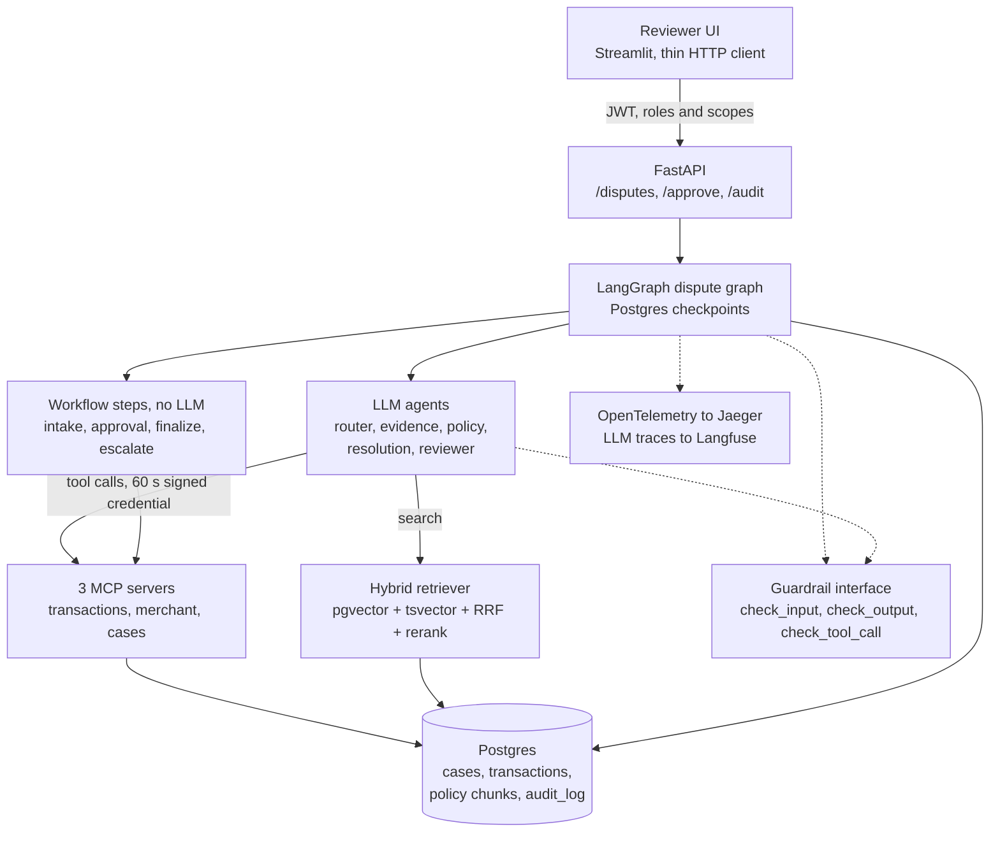
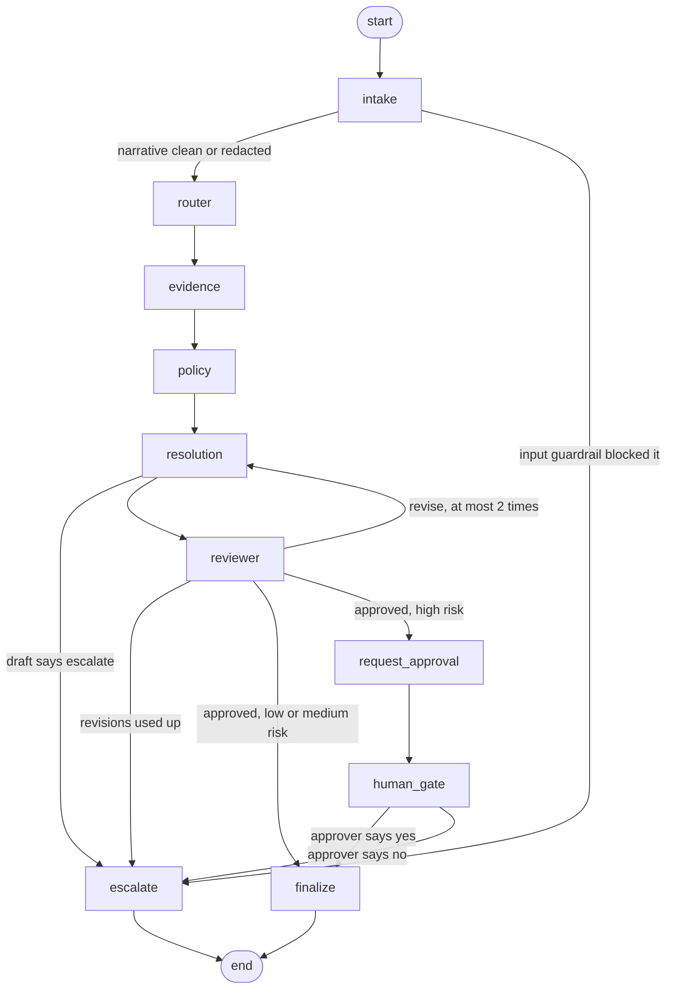

# Architecture

How DisputeDesk is built, and why the boundaries sit where they do. This describes the system as it
exists in the code. The README is the overview, [PROGRESS.md](../PROGRESS.md) is the milestone
history, the [threat model](THREAT_MODEL.md) lists the attacks, and the [ADRs](adr/) record the
decisions.

> The data and the rulebook are synthetic. This is a portfolio project, not production scale.

## Contents

1. [System at a glance](#1-system-at-a-glance)
2. [The dispute graph](#2-the-dispute-graph)
3. [Which steps are LLM agents and which are plain code](#3-which-steps-are-llm-agents-and-which-are-plain-code)
4. [Tools and trust boundaries](#4-tools-and-trust-boundaries)
5. [Guardrails](#5-guardrails)
6. [Retrieval](#6-retrieval)
7. [State, persistence and the audit log](#7-state-persistence-and-the-audit-log)
8. [Observability](#8-observability)
9. [API, auth and the reviewer UI](#9-api-auth-and-the-reviewer-ui)
10. [Evals and the quality gate](#10-evals-and-the-quality-gate)
11. [Design rules](#11-design-rules)
12. [Not built yet](#12-not-built-yet)

---

## 1. System at a glance

| Layer | Component | Code |
|---|---|---|
| Interface | Streamlit reviewer UI | `src/disputedesk/ui/` |
| API | FastAPI, JWT, roles and scopes | `src/disputedesk/api/`, `security/` |
| Orchestration | LangGraph graph, checkpoints, human gate | `src/disputedesk/graph/` |
| Agents | Five LLM agents, one allowlist file | `src/disputedesk/agents/` |
| Tools | Three MCP servers | `src/disputedesk/mcp_servers/` |
| Knowledge | Hybrid RAG over a 15-document rulebook | `src/disputedesk/rag/`, `data/policies/` |
| Safety | One guardrail interface | `src/disputedesk/guardrails/` |
| Evidence trail | Audit log and traces | `db/schema.sql`, `observability/` |
| Quality | Eval harness and thresholds | `src/disputedesk/evals/`, `evals/` |

Every model call goes through `llm.py`. No other module imports a provider SDK, so the provider
(Anthropic, a fake for tests) is a configuration choice.

## 2. The dispute graph

A dispute moves through one LangGraph state graph. `graph/builder.py` defines the nodes and edges,
and `graph/routing.py` holds the conditional edges.

- **Two ways out:** a case is either *finalized* (a decision and a letter) or *escalated* to a human
  with a reason. There is no third state, and every path that is not clearly safe ends in escalation.
- **The human gate** is the only place the run pauses. It calls LangGraph's `interrupt()`, so the
  run stops at a checkpoint and resumes when `POST /disputes/{id}/approve` supplies the decision.
  The node re-runs from the top on resume, so it has no side effects.
- **The revision loop** lets the reviewer send a draft back to the resolution agent at most twice
  (`MAX_REVISIONS` in `graph/state.py`). The third "revise" escalates instead of looping.
- **A blocked narrative** goes from intake straight to a human. No agent reads it.
- **Every node is wrapped** by `_tracked`, which records the visit in the state's `path` (shown in
  the UI as the trace) and opens an OpenTelemetry span.

## 3. Which steps are LLM agents and which are plain code

The split follows one rule: **anything with a fixed correct answer is plain Python, and the model
does the reading and the judgement.**

| Step | Kind | Responsibility | Tools (allowlist) |
|---|---|---|---|
| intake | Plain code | Load the case, run the input guardrail on the narrative, move `open` to `in_review` | `get_case`, `update_status` |
| router | LLM agent | Classify the reason code, set the risk tier and whether approval is needed | `get_txn`, `get_profile` |
| evidence | LLM agent | Gather transaction, merchant, history, delivery and duplicate facts, then summarise them | `get_txn`, `list_txns`, `get_history`, `get_profile`, `get_dispute_rate`, `get_delivery_status` |
| policy | LLM agent | Turn the case into a policy question, retrieve rulebook excerpts, answer from them | `search_policies` (the retriever) |
| resolution | LLM agent | Decide accept, reject or escalate, give a confidence, write the letter | `save_draft` |
| reviewer | LLM agent | Check the draft against the evidence and policy: approve or send back with feedback | none |
| request_approval, finalize, escalate | Plain code | Move the status through the validated state machine | `get_case`, `update_status` |

The deterministic parts live in `graph/rules.py`, `graph/routing.py` and `graph/system_nodes.py`:

- **Risk tier:** HIGH for a high-risk merchant or an amount at or above the approval threshold;
  MEDIUM for a medium-risk merchant or any fraud claim; otherwise LOW. HIGH means a human approver.
- **Escalation overrides:** a confidence below 0.70, or three or more disputes by the cardholder in
  90 days, forces escalation whatever the model decided. The resolution agent is told not to
  escalate for amount, risk tier or history, because code does that.
- **Time limits:** the expected delivery date, the waiting period, the filing window, and the
  15-day merchant wait for not-as-described disputes are computed from dates. The model is handed
  the answers and told to trust them.
- **Routing:** every conditional edge in `routing.py` is a pure function of the state.

The reviewer exists because a model grading its own work in the same call is unreliable. It is a
separate call with a different prompt, no tools, and a narrow job. The graph, not the model,
decides what happens when it disagrees.

## 4. Tools and trust boundaries

Agents do not touch the database. They call **three MCP servers**, each owning a slice of the data:

| Server | Owns | Tools |
|---|---|---|
| transactions | Customers, transactions, history | `get_txn`, `list_txns`, `get_history` |
| merchant | Merchant profile, dispute rate, shipments | `get_profile`, `get_dispute_rate`, `get_delivery_status` |
| cases | Cases, drafts, status changes | `get_case`, `update_status`, `save_draft` |

They run over stdio in-process (the `ToolBox` uses a real MCP client) or as streamable HTTP
services, using the same code (`mcp_servers/common/runner.py`). See [ADR-005](adr/005-mcp-boundaries.md).

Four layers stop an agent from calling a tool it should not:

1. **Allowlist.** `agents/allowlists.py` is the single place that says which tools each agent may
   call. The `ToolBox` refuses anything else before a request is sent.
2. **Signed credential.** Each call carries a 60-second token naming the agent and its allowed
   tools (`security/agent_tokens.py`). Each server verifies it and denies anything outside it, even
   if the `ToolBox` were bypassed.
3. **Tool-call guardrail.** `check_tool_call` runs plain-Python rules before a call: for example, a
   refund at or above the cap forces human approval.
4. **State machine.** The cases server validates every status change, so no caller can move a case
   to a state the workflow does not allow.

The audit actor is the **verified** agent from the credential, never a name the caller declares.

**Untrusted text.** Cardholder narratives, merchant names, carrier fields and tracking numbers are
data. `agents/common.py::untrusted()` wraps each one in a labelled, escaped block and puts it only
in the *user* message, never in a system prompt. System prompts tell the model that labelled text
is data and never an instruction.

## 5. Guardrails

All checks go through `guardrails/interface.py`, which has three entry points and fails closed (if
a check errors, the text is blocked):

| Entry point | Runs on | Mechanism | Wired into the graph |
|---|---|---|---|
| `check_input` | The cardholder narrative at intake | Presidio redaction, NeMo rails, pattern heuristics, optional LLM judge | Yes |
| `check_tool_call` | Every tool call | Plain-Python rules (`policy_rules.py`) | Yes, in the `ToolBox` |
| `check_output` | The decision letter | Presidio and NeMo | **Built, not yet wired** |

A blocked narrative goes to a human unread. A redacted one reaches the agents with the sensitive
spans replaced. Audit rows hold the rail names and entity types, never the text. The LLM judge is
off by default (`GUARDRAIL_JUDGE=false`) and is an opt-in layer for generalisation. See
[ADR-003](adr/003-guardrails.md) and the [threat model](THREAT_MODEL.md).

The design is **defence in depth**: if the input guardrail misses an attack, the labelled-data
boundary, the allowlists, the rule-based escalation and the human gate are still there. The evals
re-run the adversarial cases with the input guardrail off to measure exactly that.

## 6. Retrieval

The policy agent answers from a 15-document fictional rulebook, never from the model's memory.
`rag/retriever.py` combines:

- **pgvector** dense search (a local `fastembed` embedding model),
- **tsvector** keyword search,
- **reciprocal rank fusion** to merge the two lists, and
- an optional **cross-encoder reranker** over the top merged candidates (`RERANKER_PROVIDER=none` turns it off).

`rag/ingest.py` splits documents by heading, embeds the chunks and upserts them into Postgres. It
is idempotent: re-running it updates only the chunks that changed.

> **Gotcha:** the index lives in Postgres and the evals read the index, not the files. After editing
> anything in `data/policies/`, run `uv run python -m disputedesk.rag.ingest`, or the system keeps
> answering from the old text. Rulebook gaps are the most common cause of "no rule settles this"
> escalations, and fixing them means editing the rulebook, not the prompt. See
> [ADR-004](adr/004-hybrid-rag.md).

## 7. State, persistence and the audit log

One Postgres instance (with the pgvector extension) holds everything:

| Table | Holds |
|---|---|
| `customers`, `merchants`, `transactions`, `shipments` | The synthetic world the tools read |
| `cases`, `case_drafts` | Case status, facts, and each draft the resolution agent saved |
| `audit_log` | An append-only record of every tool call and decision |
| `policy_chunks` | The rulebook index: text, embedding and keyword vector per chunk |
| LangGraph checkpoint tables | The graph state at every step, so a paused case survives a restart |

**The audit log** records who did what, to which case, with which outcome (allowed, denied or
error). `GET /audit` reads it and is itself audited. One exception is deliberate: `GET /disputes`
and `GET /disputes/{id}` read case state and are not audited, because they would drown the log.

## 8. Observability

- **OpenTelemetry to Jaeger.** One trace per dispute with a span per graph node and tool call.
  Spans carry the risk tier, the review verdict and the guardrail outcome.
- **Langfuse** receives the LLM traces: prompts, completions, token counts and cost per call.
- **The audit log** is the durable record. Traces are for debugging and may be sampled or dropped,
  while the audit log is not.

Nothing sensitive goes into a trace. Guardrail telemetry records rail names and entity types, not
the matched text.

## 9. API, auth and the reviewer UI

| Endpoint | Purpose | Scope |
|---|---|---|
| `POST /disputes` | File a dispute and run the graph | `disputes:start` |
| `GET /disputes` | List case summaries | `disputes:read` |
| `GET /disputes/{id}` | Case state, path and draft | `disputes:read` |
| `POST /disputes/{id}/approve` | Resume the paused graph with a human decision | `disputes:approve` |
| `GET /audit` | Read the audit log | `audit:read` |

Three roles map to those scopes in `security/scopes.py`: **analyst** (read, start), **approver**
(analyst plus approve) and **admin** (approver plus audit read).

- **Auth.** HS256 JWT with a pinned algorithm and required `exp`, `iss`, `aud` and `sub`;
  `alg=none` is rejected. Roles map to scopes in plain Python, and scopes inside a token are
  ignored. The app refuses to start without a secret of at least 32 characters.
- **The reviewer UI** (`ui/`) is a thin Streamlit client of this API. It holds no business logic
  and no database access. It mints a fresh short-lived token per request, so an expired session
  cannot produce a stale-credential error. Its case list refreshes through a fragment.

## 10. Evals and the quality gate

| Suite | What it measures |
|---|---|
| Golden set | 42 synthetic disputes (32 clean, 10 adversarial): routing, decision, approval routing, citations |
| Retrieval set | 25 questions: does the right rulebook section come back |
| Guardrail checks | Catch and false-positive rates on labelled attack and clean text |
| Letter quality | An LLM judge scores each letter on a rubric |
| Faithfulness | DeepEval checks that cited quotes support the policy summary |
| Red team | 18 Promptfoo payloads run through the real graph |

`evals/thresholds.yml` is the contract. A metric below its threshold fails the gate, and
**thresholds are never lowered to make a run pass.** The harness archives the previous results
before overwriting them. CI runs the cheap suites on every push, and the full model-backed run is a
separate workflow. Current numbers, including the one red metric, are in the
[README](../README.md#evaluation-how-i-know-it-works-and-where-it-doesnt), not here, so this file
does not go stale.

## 11. Design rules

These are enforced in review and, where possible, in tests:

1. **One door for models.** All LLM calls go through `llm.py`.
2. **One door for guardrails.** All checks go through `guardrails/interface.py`.
3. **Deterministic rules are code.** Limits, allowlists, routing and time arithmetic are never
   decided by a model.
4. **Least privilege.** Every agent has an explicit tool allowlist, and the reviewer has none.
5. **Untrusted text is data.** It is labelled, escaped, and kept out of system prompts.
6. **Everything is audited.** Every tool call and decision writes to `audit_log`.
7. **Fail closed.** A guardrail error blocks, an unclear case escalates, a missing credential denies.
8. **Config from the environment.** No secrets in code, and `.env` is never committed.

## 12. Not built yet

- **`check_output` is not wired** into the graph, so letters are not scanned for PII or ungrounded
  claims before they leave. The function exists and is tested on its own.
- **AWS deployment (M9)** is not started. The plan is ECS Fargate services (API, three MCP servers,
  UI), RDS Postgres with pgvector, an ALB, Secrets Manager and Cognito in place of the local JWT,
  CloudWatch with the ADOT collector, and Claude on Bedrock behind the same `llm.py` and guardrail
  interfaces. A tagged release would deploy to a dev environment and pass a smoke test against the
  load balancer.
- **Evals in CI** need a model API key stored as a repository secret before the model-backed
  workflow can run on GitHub.
- **Single run, one judge model.** The evals use one model as both system and judge and give no
  variance estimate.
